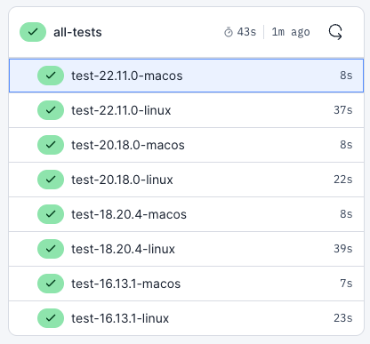

# Matrix Builds

**Description:**

We want to run our job across multiple versions of Node and on both Mac and Linux. Utilize Matrix builds to accomplish this without adding a job for each setup.

**Goals:**

- Add a matrix condition to run the jobs for both `linux` and `macos`
- Add a matrix condition to run the jobs for the following node versions: `16.13.1`, `18.20.4`, `20.18.0`, `22.11.0`
- Share link to green build that executed all 8 jobs, should look like this:

**Help:**

  
Spoiler warning

  * https://circleci.com/docs/2.0/configuration-reference/#matrix-requires-version-21

